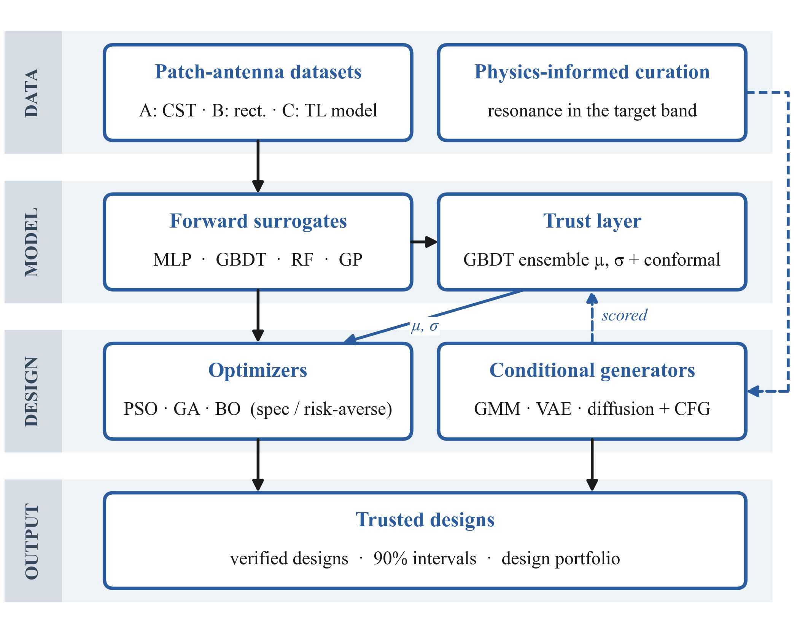

# Reliable machine-learning design of microstrip patch antennas

Code, results and figure scripts for *Reliable Machine-Learning Design of Microstrip Patch
Antennas With Conformal Calibration, Deep Generative Inverse Design, and Multi-Dataset
Validation* (manuscript under preparation for IEEE Access).

A neural surrogate predicts a patch antenna's |S11| in microseconds, so it is natural to let an
optimizer search it. But the optimizer is drawn to exactly the regions where the surrogate is
most wrong. This repository makes the surrogate state its own uncertainty, using an ensemble
calibrated by split-conformal prediction. A trust gate rejects any candidate whose calibrated
interval does not clear a −10 dB return-loss mask. Designs come from risk-averse optimization
or from conditional generators (GMM, VAE, and a diffusion model with classifier-free guidance).
Everything is tested on three independent datasets over repeated seeds, with paired tests and
Holm correction.



## Main findings

| | Result |
|---|---|
| Calibration | Raw ensemble intervals cover 59.6 % of test points at a nominal 90 %; conformal intervals cover 89.9–90.1 % in every seed. The same step brings deep ensembles, MC dropout, CQR and GPs to 89.7–91.2 %. |
| Trust gate | Rejects the over-optimistic single-network optimum in 9 of 10 seeds without simulation; optimizing the calibrated ensemble cuts the gap to the nearest real design from 12.7 to 3.2 dB (p = 0.011). |
| Generators | Hit the target 35–39 % of the time vs 5.5 % for random sampling; 92–100 % mask compliance vs 34 % (p < 0.001). Guidance raises diffusion compliance to 99.6 % at a controllable cost in diversity. |
| Data curation | Physics-informed selection of training designs doubles generator compliance on a sparsely sampled dataset. |
| Cost | Guided diffusion yields compliant designs about ten times more cheaply than multi-start optimization, although each optimized design is more reliable. |

## Datasets

| | Source | Size | Obtained |
|---|---|---|---|
| A | CST full-wave patch sweeps, [Zenodo 10.5281/zenodo.17527112](https://doi.org/10.5281/zenodo.17527112) (CC-BY-4.0) | 55,053 rows | downloaded to `data/raw/` on first use |
| B | Rectangular patch full-wave sweeps, [Hugging Face](https://huggingface.co/datasets/becklabash/rectangular-patch-antenna-freq-response) | 2,051 designs | downloaded on first use by `benchmark_datasets.py` |
| C | Transmission-line / cavity patch model | generated | built in code, exact physics available |

The raw data are not redistributed here.

## Setup

```bash
pip install -r requirements.txt
pip install torch --index-url https://download.pytorch.org/whl/cpu   # deep generative models
```

Python 3.13, CPU only. Fixed seed 42 (`config.py`); multi-seed experiments set their own seeds.
On Windows with Anaconda, set `KMP_DUPLICATE_LIB_OK=TRUE` if PyTorch reports a duplicate OpenMP
runtime.

## Reproduce

**Tables and statistics from the saved results (seconds):**

```bash
python ms_stats.py        # multi-seed summaries + Holm-corrected paired tests -> results/ms_stats.md
python ext_stats.py       # UQ baselines, inverse-design baselines, dataset-B learning curve
```

**Figures in the paper (seconds):**

```bash
cd paper_figures
python make_origin_figs.py    # data figures (multi-seed versions used in the paper)
python make_ext_figs.py       # UQ-baseline comparison and dataset-B learning curve
python make_arch_flow.py      # architecture and flowchart diagrams
python make_geometry_fig.py   # patch geometry
```

The scripts write to `paper_figures/figures/`, and the committed PNGs are their output.

**Experiments from scratch (hours on a laptop CPU; each phase appends one CSV row per seed):**

```bash
python exp_multiseed.py surrogates   # 4 surrogates x 3 datasets x 10 splits
python exp_multiseed.py uq           # conformal vs raw ensemble intervals, kappa sweep
python exp_multiseed.py ensemble     # ensemble size M = 2..12
python exp_multiseed.py generative   # GMM / VAE / diffusion vs random baseline
python exp_multiseed.py guidance     # classifier-free guidance scale sweep
python exp_multiseed.py curated      # broad vs physics-curated training on dataset C
python exp_extend.py uqbase          # GBDT ensemble vs deep ensemble, MC dropout, CQR, GP
python exp_extend.py invbase         # inverse-design baselines against exact physics (dataset C)
python exp_extend.py bsize           # dataset-B learning curve
python benchmark_datasets.py         # cross-dataset generalization
python pipeline_multi.py             # full pipeline on every dataset
python run_all.py                    # single-seed end-to-end demo (surrogates -> optimizers -> UQ)
```

`regen_*.py` re-run single stages with the paper's seed and save the arrays that the figures
read (`results/*.npz`).

## Layout

```
config.py, data/          configuration; dataset-A loader (Zenodo download + caching)
models/                   MLP / GBDT / GP surrogates; bootstrap ensemble + split-conformal calibration
optimize/                 PSO, GA, Bayesian optimization, active learning, band-mask / risk-averse design
generate/                 conditional GMM, VAE and diffusion (classifier-free guidance)
evaluate/                 metrics and plots
exp_multiseed.py, ms_stats.py      multi-seed experiments and paired tests
exp_extend.py, ext_stats.py        baseline comparisons and learning curve
generate_*.py, benchmark_datasets.py, pipeline_multi.py, run_all.py   individual studies
results/                  every CSV / NPZ behind the tables and figures (results/improved/: baselines)
paper_figures/            figure scripts, shared style (figstyle.py) and the rendered figures
```

## License

Code: [MIT](LICENSE). Datasets remain under the terms set by their authors (dataset A:
CC-BY-4.0).
